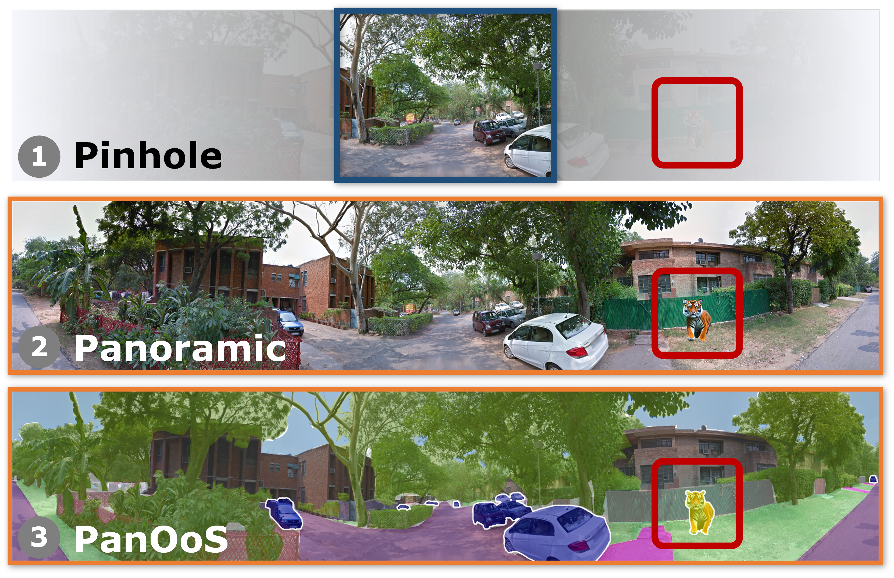
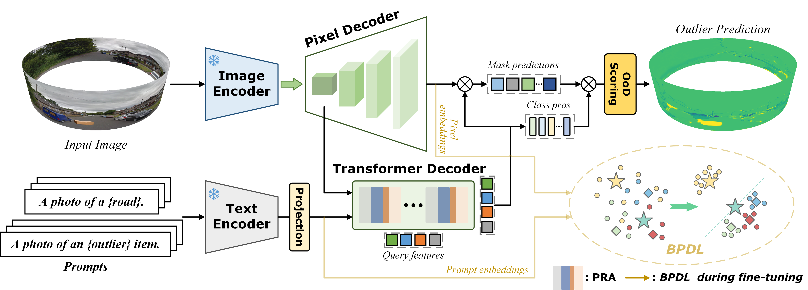

<div align="center">

# Panoramic Out-of-Distribution Segmentation

<p>
  <a href="https://github.com/MengfeiD"><strong>Mengfei Duan</strong></a>,
  <a href="https://github.com/7uHeng"><strong>Yuheng Zhang</strong></a>,
  <a href="https://scholar.google.com/citations?user=j3364z8AAAAJ"><strong>Yihong Cao</strong></a>,
  <a href="https://github.com/FeiT-FeiTeng"><strong>Fei Teng</strong></a>,
  <a href="https://github.com/xifen523"><strong>Kai Luo</strong></a>,
  <a href="https://jamycheung.github.io/"><strong>Jiaming Zhang</strong></a>,
  <a href="https://yangkailun.com/"><strong>Kailun Yang</strong></a><sup>†</sup>,
  <a href="http://robotics.hnu.edu.cn/info/1176/2960.htm"><strong>Zhiyong Li</strong></a><sup>†</sup>
</p>

<p>
  <a href="https://arxiv.org/abs/2505.03539">
    
  </a>
  <a href="https://arxiv.org/pdf/2505.03539">
    
  </a>
</p>

</div>

---

<p align="center">
  
</p>

This repository provides:

* **PanOoS**, a panoramic out-of-distribution segmentation task and evaluation protocol;
* **POS**, a prompt distribution learning framework designed for PanOoS;
* **DenseOoS**, a benchmark containing diverse outliers in complex panoramic environments;
* **QuadOoS**, a real-world benchmark captured by a quadruped robot equipped with a panoramic annular lens system.

---

## 📰 News

* **[2026-10]** DenseOoS and QuadOoS are released.
* **[2026-06]** Environment installation and dataset preparation instructions released.
* **[2025-05]** Paper released on arXiv.
* **[2025-05]** Repository initialized.

---

## ✨ Highlights

* **New task.** We formulate Panoramic Out-of-Distribution Segmentation for comprehensive and safety-aware panoramic scene understanding.

* **New framework.** We propose **POS**, a prompt distribution learning framework that adapts vision-language representations to panoramic distortions and background clutter.

* **New benchmarks.** We establish **DenseOoS** and **QuadOoS** to support the development and evaluation of panoramic out-of-distribution segmentation.

* **Strong performance.** POS substantially improves panoramic out-of-distribution segmentation while preserving competitive closed-set semantic segmentation performance.

<p align="center">
  
  <br>
  <em>Overview of the proposed POS framework.</em>
</p>

---

## 📊 Main Results

<p align="center">
  <strong>Panoramic out-of-distribution segmentation quantitative evaluation</strong>
</p>

<table align="center">
  <thead>
    <tr>
      <th rowspan="2" align="left">Method</th>
      <th colspan="3" align="center">DenseOoS</th>
      <th colspan="2" align="center">QuadOoS</th>
      <th colspan="2" align="center">Mean</th>
    </tr>
    <tr>
      <th align="center">AuPRC ↑</th>
      <th align="center">FPR<sub>95</sub> ↓</th>
      <th align="center">mIoU ↑</th>
      <th align="center">AuPRC ↑</th>
      <th align="center">FPR<sub>95</sub> ↓</th>
      <th align="center">AuPRC ↑</th>
      <th align="center">FPR<sub>95</sub> ↓</th>
    </tr>
  </thead>
  <tbody>
    <tr>
      <td colspan="8" align="left">
        <strong><em>Per-pixel methods</em></strong>
      </td>
    </tr>
    <tr>
      <td align="left">PEBAL</td>
      <td align="center">16.39</td>
      <td align="center">7.59</td>
      <td align="center">46.29</td>
      <td align="center">11.34</td>
      <td align="center"><u>39.25</u></td>
      <td align="center">13.87</td>
      <td align="center"><u>23.42</u></td>
    </tr>
    <tr>
      <td align="left">DenseHybrid</td>
      <td align="center">24.44</td>
      <td align="center">7.74</td>
      <td align="center">45.19</td>
      <td align="center">19.09</td>
      <td align="center"><strong>33.86</strong></td>
      <td align="center">21.77</td>
      <td align="center"><strong>20.80</strong></td>
    </tr>
    <tr>
      <td colspan="8" align="left">
        <strong><em>Mask-transformer-based methods</em></strong>
      </td>
    </tr>
    <tr>
      <td align="left">EAM</td>
      <td align="center">17.97</td>
      <td align="center"><u>6.46</u></td>
      <td align="center"><u>61.58</u></td>
      <td align="center">33.05</td>
      <td align="center">79.66</td>
      <td align="center">25.51</td>
      <td align="center">43.06</td>
    </tr>
    <tr>
      <td align="left">Mask2Anomaly</td>
      <td align="center">36.28</td>
      <td align="center">8.79</td>
      <td align="center">48.10</td>
      <td align="center">25.93</td>
      <td align="center">92.55</td>
      <td align="center">31.10</td>
      <td align="center">50.67</td>
    </tr>
    <tr>
      <td align="left">RbA</td>
      <td align="center"><u>51.31</u></td>
      <td align="center">21.87</td>
      <td align="center">57.54</td>
      <td align="center"><u>34.12</u></td>
      <td align="center">90.34</td>
      <td align="center"><u>42.71</u></td>
      <td align="center">56.11</td>
    </tr>
    <tr>
      <td align="left"><strong>POS (Ours)</strong></td>
      <td align="center"><strong>85.56</strong></td>
      <td align="center"><strong>0.45</strong></td>
      <td align="center"><strong>63.30</strong></td>
      <td align="center"><strong>48.13</strong></td>
      <td align="center">85.22</td>
      <td align="center"><strong>66.85</strong></td>
      <td align="center">42.84</td>
    </tr>
  </tbody>
  <tfoot>
    <tr>
      <td colspan="8" align="left">
        <sub>
          All values are reported in percentage points (%).
          Higher AuPRC and mIoU values are better, whereas lower
          FPR<sub>95</sub> values are better. The best and second-best
          results are highlighted in <strong>bold</strong> and
          <u>underlined</u>, respectively.
        </sub>
      </td>
    </tr>
  </tfoot>
</table>

---

## 🚀 Getting Started

### 1. Clone the Repository

```bash
git clone https://github.com/MengfeiD/PanOoS.git
cd PanOoS
```

### 2. Install the Environment

Follow the complete installation instructions in
[`docs/INSTALL.md`](docs/INSTALL.md).

### 3. Prepare the Datasets

Follow [`docs/DATASET.md`](docs/DATASET.md) to download and organize
DenseOoS, QuadOoS, and the auxiliary training datasets.

---

## 🤝 Acknowledgments

This project builds upon several excellent open-source projects:

* [Mask2Former](https://github.com/facebookresearch/Mask2Former)
* [RbA](https://github.com/NazirNayal8/RbA)
* [FC-CLIP](https://github.com/bytedance/fc-clip)

We sincerely appreciate the tremendous efforts of their authors and contributors.

---

## 📚 Citation

If you find this work useful in your research, please consider citing the following paper:

```bibtex
@article{duan2025panoramic,
  title   = {Panoramic Out-of-Distribution Segmentation},
  author  = {Duan, Mengfei and Zhang, Yuheng and Cao, Yihong and Teng, Fei and Luo, Kai and Zhang, Jiaming and Yang, Kailun and Li, Zhiyong},
  journal = {arXiv preprint arXiv:2505.03539},
  year    = {2025}
}
```
